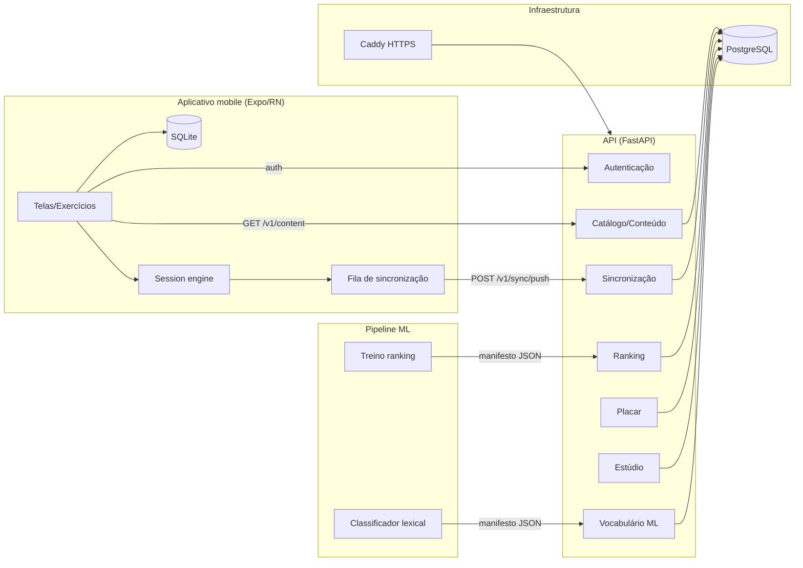
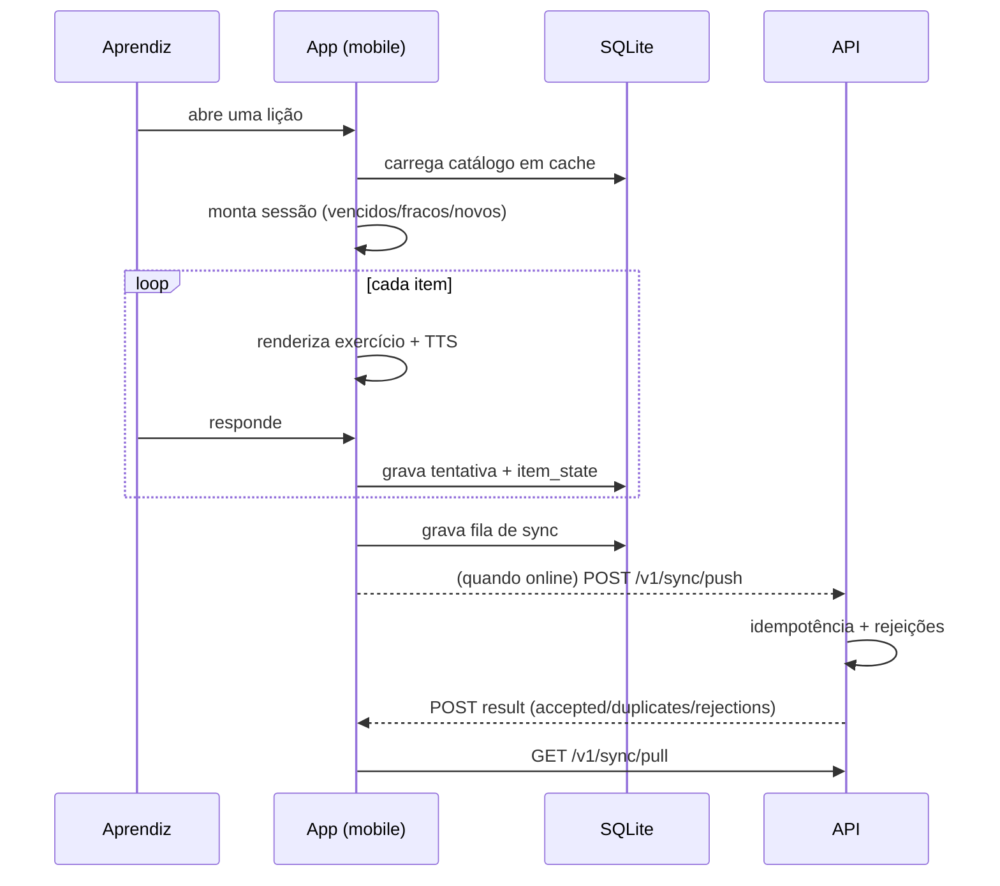
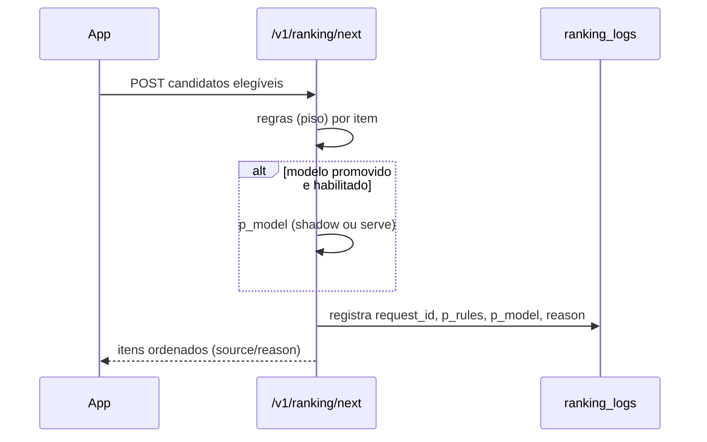

# Prosa — Arquitetura

> **Propósito:** descrever o estilo arquitetural, as camadas, os componentes e as decisões
> técnicas do **Prosa**.

Documentos relacionados: [05 — Stack tecnológica](05-stack-tecnologica.md) ·
[06 — Banco de dados](06-banco-de-dados.md) · [09 — Estrutura](09-estrutura-do-projeto.md) ·
[adr/](adr/).

## Estilo arquitetural

O sistema é composto por **três aplicações** que conversam por HTTP/JSON:

- **`apps/mobile/`** — cliente *offline-first* (Expo/React Native), que mantém uma cópia
  local do catálogo e da fila de sincronização.
- **`apps/api/`** — API REST (FastAPI), fonte única do catálogo e do estado compartilhado.
- **`ml/`** — pipeline de treino/avaliação (Python), que gera manifestos JSON consumidos
  pela API em Python puro (sem NumPy/scikit-learn em runtime).

O conteúdo é **server-driven**: o servidor é a única fonte do catálogo; o aplicativo embarca
um *bundle semente* para o primeiro boot offline e, depois, baixa e valida o catálogo
(`GET /v1/content` com `ETag`/`304`).

## Camadas da API

A API (`apps/api/app/`) é organizada em módulos com responsabilidade única:

| Camada/Arquivo | Responsabilidade |
|---|---|
| `main.py` | Composição do app FastAPI, `lifespan`, montagem de `/admin` |
| `config.py` | Configuração via `pydantic-settings` (`.env`) |
| `db.py` | Engine/session SQLAlchemy |
| `models.py` | Entidades ORM (SQLAlchemy 2 declarativo) |
| `schemas.py` | Modelos Pydantic de entrada/saída (contratos de sync) |
| `security.py` | JWT (HS256) e Argon2id |
| `deps.py` | `current_user` (autenticação bearer) |
| `auth.py` | `register/login/refresh/logout/firebase` |
| `content.py` | `GET /v1/content` (ETag, bundle) |
| `content_data.py` | Catálogo curado à mão (fonte da verdade) |
| `content_types.py` | Enumeração de tipos de exercício (espelha contrato) |
| `content_ids.py` | IDs canônicos e tradução de IDs legados |
| `content_lint.py` | Validação pedagógica do bundle |
| `seed.py` | Seed idempotente do banco a partir de `content_data.py` |
| `sync.py` | `push`/`pull` idempotentes |
| `me.py` | Perfil e consentimento de pesquisa |
| `leaderboard.py` | Placar e ligas |
| `word_studio.py` | Curadoria lexical e feedback humano |
| `lexical_difficulty.py` | Inferência local do classificador lexical |
| `admin.py` | Estúdio local de conteúdo e mídia |
| `firebase.py` | Verificação de ID tokens do Firebase Auth |
| `word_bank.py` | Carga do banco de candidatos (corpus) |
| `ranking/` | Serviço de ranking (`service`, `rules`, `model`, `features`, `scheduler`) |

## Camadas do mobile

| Camada | Responsabilidade |
|---|---|
| `app/` (telas) | `index`, `auth`, `placement`, `lessons`, `progress`, `profile`, `ranking`, `achievements`, `lesson/[id]`, `trail/[stage]` |
| `src/api/` | cliente HTTP (`client.ts`, `errors.ts`) |
| `src/content/` | cache do catálogo (`store.ts`), validação (`schema.ts`) |
| `src/storage/` | SQLite (`database.ts`), sessão (`session.ts`) |
| `src/sync/` | contrato de sync, fila, retry (`use-sync.ts`, `session-retry.ts`) |
| `src/domain/` | lógica pura (scheduler, session, learning, levels, points, league, achievements, trail, placement) |
| `src/components/` | UI (`exercises/`, `ui/`, `AudioButton`, etc.) |
| `src/store/` | estado (Zustand) de autenticação e estudo |

## Decisões técnicas centrais (resumo)

| Decisão | ADR | Resumo |
|---|---|---|
| Conteúdo server-driven | [ADR 0001](adr/0001-conteudo-server-driven.md) | Servidor é a única fonte do catálogo; `ETag`/`304`; bundle semente |
| Modelo de conteúdo (trilhas, sílabas, frases) | [ADR 0002](adr/0002-modelo-de-conteudo.md) | Dois eixos: portão por `required_letters`; trilha só agrupa |
| Repetição espaçada por item | [ADR 0003](adr/0003-repeticao-por-item.md) | Estado por item; sessão reapresenta erros; progresso derivado |
| ML como ranking no servidor | [ADR 0004](adr/0004-reabertura-de-ml-como-ranking.md) | Modelo só reordena elegíveis; gate de promoção; shadow mode |
| Classificador de dificuldade lexical | [ADR 0005](adr/0005-classificador-dificuldade-lexical.md) | Regressão logística multinomial sobre features silábicas |

## Fluxos principais

### Fluxo de uma sessão de estudo (offline)

### Fluxo de ranking

## Limites e acoplamentos

- A API **não importa NumPy/scikit-learn** em runtime; o ranking e o classificador lexical
  são aplicados a partir de manifestos JSON (coeficientes) em Python puro.
- `apps/api/app/ranking/` e `apps/mobile/src/domain/scheduler.ts` são **portas espelhadas**
  da mesma lógica (repetição espaçada), garantindo que o que se avalia (`ml/replay.py`) é o
  que se serve.
- Os contratos em `contracts/*.json` são a fonte única de tipos/invariantes; API e mobile
  os espelham e os testes falham em caso de divergência.
