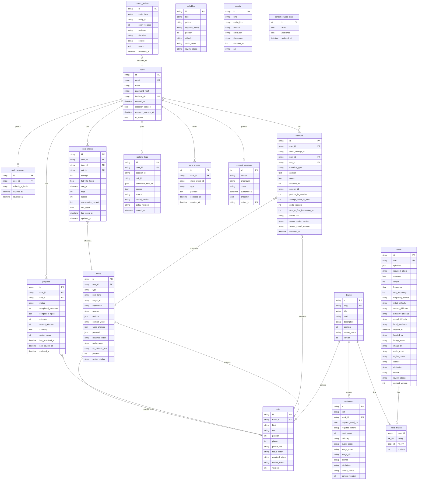

# Prosa — Banco de dados

> **Propósito:** descrever o modelo de dados do **Prosa** (entidades, relacionamentos,
> restrições e migrations), com diagrama ER.

Documentos relacionados: [04 — Arquitetura](04-arquitetura-prosa.md) ·
[09 — Estrutura](09-estrutura-do-projeto.md).

Fonte da verdade: [`apps/api/app/models.py`](../apps/api/app/models.py).

## Visão geral

Dois eixos de dados (ADR 0002):

1. **Conteúdo** — catálogo pedagógico server-driven, versionado e revisado.
2. **Aprendizagem** — tentativas, estado por item, progresso, ranking e sincronização.

## Diagrama ER

## Restrições importantes

| Restrição | Local | Motivo |
|---|---|---|
| `users.email` único | `models.py` | identidade de login |
| `users.firebase_uid` único | `models.py` | vínculo do login social |
| `attempts (user_id, client_attempt_id)` único | `models.py` | idempotência de tentativas |
| `item_states (user_id, item_id)` único | `models.py` | um estado por item por usuário |
| `progress (user_id, unit_id)` único | `models.py` | um resumo por unidade |
| `sync_events (user_id, client_event_id)` único | `models.py` | idempotência da fila |
| `words.text` único | `models.py` | texto canônico da palavra |
| FKs `ondelete=CASCADE` em `auth_sessions` | `models.py` | limpeza de sessões |

## Migrations

As migrations estão em `apps/api/migrations/versions/` e cobrem a evolução do schema:

| Migration | Conteúdo |
|---|---|
| `6fb301185a23_initial_schema.py` | schema inicial |
| `20260910_progressive_learning.py` | aprendizagem progressiva |
| `20260910_progress_metadata.py` | metadados de progresso |
| `20260910_remove_writing_exercises.py` | remoção de exercícios de escrita |
| `20260910_word_requirements.py` | requisitos de letras em palavras |
| `20260915_attempt_context.py` | contexto de sessão em tentativas |
| `20260915_canonical_content_ids.py` | IDs canônicos + mesclagem de duplicatas |
| `20260915_exercise_word_choices.py` | escolhas de palavra |
| `20260916_content_model.py` | modelo de conteúdo (trilhas, sílabas, frases) |
| `20260916_content_studio.py` | estado do Estúdio |
| `20260917_item_states.py` | estado por item |
| `20260918_ranking_logs.py` | registro do ranking |
| `20261018_word_ml_labels.py` | rótulos de ML lexical |
| `20261021_user_name.py` | nome do usuário |
| `20261022_google_login.py` | login Google (Firebase) |

## Notas

- O desenvolvimento usa SQLite (`sqlite+pysqlite:///./alfabetiza.db`); produção usa
  PostgreSQL (`postgresql+psycopg://...`), conforme `infra/compose.yaml`.
- O `downgrade` da migration `20260916_content_model.py` é **lossy** para metadados novos e
  unidades temáticas (ADR 0002).
- Palavras candidatas do corpus entram em `words` com `review_status = candidate` e
  `frequency_source = corpus-santos-toni`; nunca saem no bundle.
